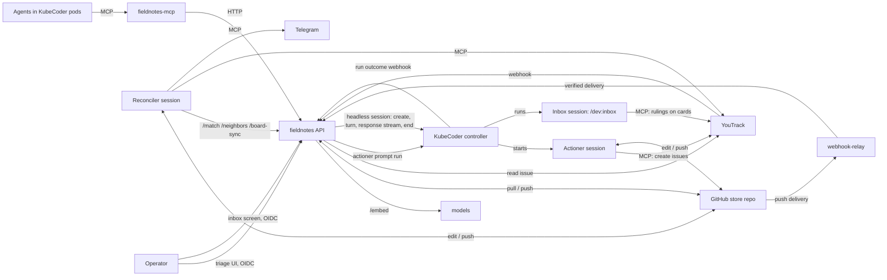
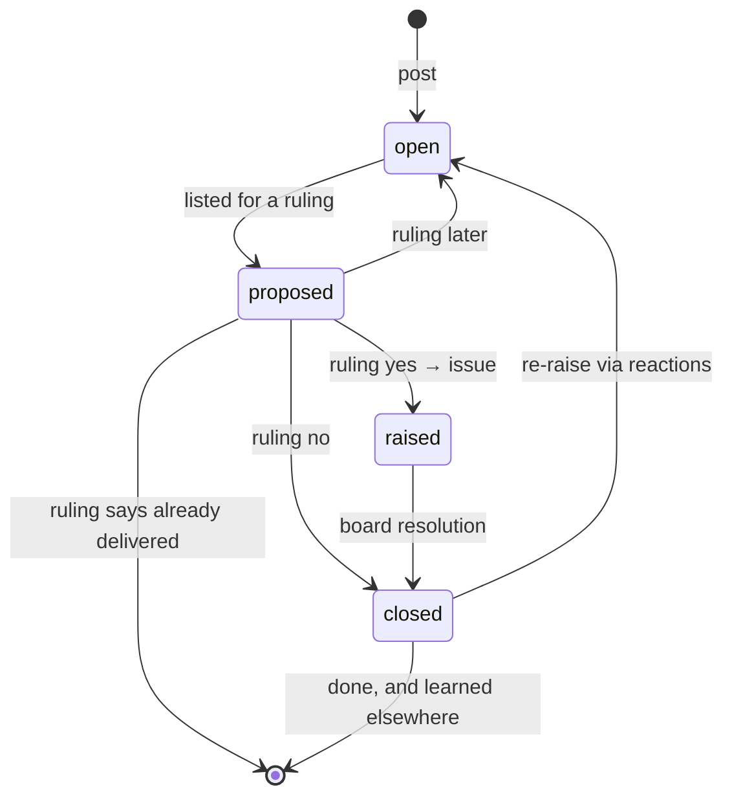

# Fieldnotes: design

What Fieldnotes is, the decisions it is built on, its numbered requirements and its technical design.
This is the design the first version is built from, scoped as a proof of concept: enough to find out
whether the idea proves its value. The requirement numbers (`FR-n`, `NFR-n`) are what tests and
commits cite. A decision this doc leaves open is the operator's to rule, not something to settle in
code.

## Purpose

Fieldnotes is the operator's complaint box: a curated, cross-project store for the friction agents
run into while they work. What got in an agent's way and is not theirs to fix now, which today
ends up in a close-out report with thirty other findings or in a memory file nobody else reads,
goes here instead. It still reaches the operator, through a second, lower-priority channel that is
curated before they see it, and the close-out report stays on topic. An agent posts an observation;
the server answers with what the store already knows about it, the operator's ruling included, and
the agent reacts to that instead of re-posting. That post-time answer is how knowledge reaches the
next agent, without any search tool.

The store is temporary by design. What is reported gets fixed or documented, and then its
observation is deleted; what the operator decides not to act on stays, with the reason, as the
answer the next agent gets.

A scheduled reconciler session curates the store, researches selected observations, checks the board
and puts what is worth a ruling in the operator's triage queue. The operator rules in the triage UI;
an actioner session, which the UI starts when the operator submits, turns rulings into YouTrack
issues and recorded decisions. An observation closes when the board says the work is done or will not
be done, and leaves the store once what it says is better learned somewhere else. A decision not to
act stays, and its reason is part of the answer the next reporter gets: for those the store does the
job a memory note used to do.

The tool exists to take work off the operator that the operator does not want to do, so that
observations with potential value are not lost when a project's close-out pile is cleared in one
sweep.

The app is also where the operator holds the tracker's inbox sitting (ruled 2026-10-10): the
`dev` plugin's `/dev:inbox` skill, which sorts every project's new cards, hand-backs and operator
actions with the operator in one exchange, runs as a headless session in the store's environment,
and the operator holds that exchange on a second screen of the app, a chat. The sitting is the
tracker's, not Fieldnotes': the app lends it the screen and the session, and nothing of it enters
the store.

Working names: the store is Fieldnotes, an item is an observation.

## Decisions

The value sits in the reconciler and in the post-time duplicate response; capture is plumbing.
Everything below follows from that.

| Topic | Decision | Rationale |
| --- | --- | --- |
| Scope | Fieldnotes takes friction: what cost an agent time or got in its way and is not theirs to fix now. The reporting agent sorts what it notices: small or in scope → do it; urgent, a product bug, or a change to the product it is working on (a refactoring, a design suggestion) → the close-out report, because the operator has a say in the product and decides there; everything else that got in the way, however minor → Fieldnotes. | Ruled after gate 2: an agent can think of a hundred hints in any decent chunk of work, and a hint with no friction behind it never finds the agent who needs it, since the store is only reached by reporting. Friction is self-limiting and self-routing. It also takes the long tail out of close-out reports, which regularly ran past thirty findings. "At least to start out with." |
| Category | Enum `hint` / `idea` / `friction`, no `bug`. Every post is friction; the category says what comes with it: `friction` the complaint alone, `hint` the complaint and what got the reporter past it, `idea` the complaint and how they would remove it. Non-normative, the reconciler may recategorize. | The enum and both surfaces stay as built, so widening the scope later is a change of words. A `hint` tells the reconciler the workaround is already in the text. Product bugs go to the operator through the close-out report. |
| Duplicates | `post` returns the candidates that clear the *related* threshold, at most 3, open and closed, with their reaction counts and what was ruled on them, and creates nothing; the reporter reacts, or creates with `force`. When nothing clears the threshold it creates and returns no candidates. | This response is the knowledge-delivery moment, so it must not cry wolf: a list that is always three long teaches the reporter to ignore it. Closed items stay matchable for as long as they are kept, so recurrence becomes a re-raise signal and a ruling reaches whoever meets the thing next. |
| Reactions | One tool `react(id, emoji, text?, repo, session?)`; emoji uncurated, allows 👎. | Vote and comment merge cleanly; the emoji carries the claim type, text only when there is new information. |
| Agent search | None. Only `post`, `react`, `get`. What comes back from a `post` is to be trusted: the statement is the reconciler's, which has read every report across projects, and the `reason` is the operator's. | The store is not a reference. It is temporary: everything in it is on its way to being fixed or documented, and is deleted when it is. A search tool would make agents treat a complaint box as documentation. First ruled on the grounds that observations are unverified; re-ruled after gate 2, when curation and rulings turned out to carry most of what comes back. |
| Reconciler | A session scheduled by a KubeCoder timer on a skill in the store repo, not a server feature. It owns the observation files and has free rein over them; everything outside the store is a proposal. | Keeps the server dumb; all judgment lives in versioned skills. |
| Vetting | The reconciler writes only the triage items, and on each item it would bet on, a draft of the ruling, marked guessed and shown with a robot icon; the operator still reviews every item and submits it. Documentation changes are recommended in text and become issues after a `yes` ruling, like everything else. | Docs are what every later agent reads; a wrong edit propagates. Ruling history will show what can be delegated later. Ruled 2026-10-10, from the ruling history: safe bets come drafted, the operator still sees and submits every one, and an untouched draft goes with Submit with no check that they looked, which is theirs to own. |
| Output | Triage items in the store, one file per observation listed (ask, evidence, recommendation, impact, every report on it → ruling), plus a Telegram message with the size of the operator's queue and the triage UI's address. No cap, no threshold. An item stays in the queue until it is ruled; the reconciler lists an observation again only when it has something new to say. | A cap drops important items when volume is high and pads when it is low. Rulings are also calibration data for the next pass. Ruled 2026-09-26 with the triage UI: records instead of documents, so that nothing is ruled in an old document or lost in one; the document's summary and its second half, every new report word for word, went with it, the operator having read the raw reports for the while they asked for. |
| Rulings | A verb, `yes`, `no` or `later`, and a note written as the operator would say it: the reason for a `no`, the revisit trigger for a `later`, and whatever else the actioner should know, a merge included. The actioner reads a ruling; it does not parse one. When it cannot read one with confidence it asks back on the item, and the operator answers in the queue. A ruling's reason is returned to the next reporter whose post matches. | "no with reason" is the decision record; "later" is where evidence-gathering time lives. Ruled at gate 2: the ruling is the operator's channel to the agents, used to say "I raised that card myself", "that shipped last week" and "this is expected, trust it" as often as `yes`, and no fixed grammar holds that. The verb and one note field were ruled with the triage UI. |
| Triage UI | One screen in the app: the queue as a stack, one item at a time, with the observation as it stands now in a tooltip on hover over its ID; a verb by key and a note, saved as each ruling is made; the reconciler's draft, if the item carries one, preset with a small robot icon; previous, skip and progress; a finish card whose Submit starts the actioner as a KubeCoder prompt run. Desktop only, signed in through Keycloak and gated on the `editor` client role. Every ruling is a commit through the API's write queue. On this screen triage only: no browsing observations and no dashboard. Of the actioner's runs it shows their state, as a pill in the app bar (App bar), and while a run is starting or running, its progress: an actioner page with the run's latest log lines, which takes the place of the empty stack's "Nothing to rule on" and which the pill opens over items still to rule on, until the run ends. The inbox sitting has a screen of its own (Inbox). | Ruled 2026-09-26, when the proof of concept was judged proven: the operator's work arrives as a stack ruled in minutes, with no environment to open, no file to edit and no session to attend. The store stays the one source of truth, so a closed browser loses nothing and needs no state anywhere else. Ruled 2026-10-11 for the actioner page: after a submit the operator waits on the run, and the page shows what it is doing as the inbox's working box shows what the session is doing. |
| Retirement | An observation is deleted once what it says is better learned elsewhere: the friction was fixed, or the hint went into documentation agents read anyway. The reconciler decides that on its own, as a rule when the card closes as done; the actioner does it for a ruling that says the work is already delivered. What was ruled and never carded stays for good. | The store is for what an agent cannot learn any other way. A recurrence after a deletion arrives as a fresh post, which is the signal that the fix did not hold. Git history is the record. |
| Closure | Closed when the board says so: a YouTrack webhook into the API, and a board scan at the start of each reconciler run. The link is one-way: the observation records its issue id in `card`, and the board carries nothing of ours. Outcome from a configured resolution field (Resolved, Absorbed → done; Won't Do → wont-do), pointer in a comment. No resolution MCP tool. | The board is trusted; the tool would duplicate it. The operator sets the resolution field after the issue reaches Done, so a later change must still be applied. |
| Card feedback | Any change to an observation's card, a comment included, puts the observation back in the reconciler's queue: board sync records the card's latest change on the file. The reconciler reads what changed and does with the observation what it judges right. | What the board learns about an observation, such as a solution or a proposed one, flows back into it, and so to the next agent whose post matches it. |
| Expiry | No TTL. Validity comes from 👎 reactions and the reconciler checking the project. | The TTL was a proxy for validity; project access replaces the proxy. |
| Storage | Git on GitHub, one file per observation; `last_updated` covers the whole file and drives the reconciler queue. Four statuses; condensing, merging and splitting are maintenance, not states. Embeddings are cached on the API's volume, content-addressed by model and hash of the embedded text. | Reversible edits and per-item history. The cache is disposable: deleting it costs a reindex and nothing else. |
| Matching | Brute-force over the whole store on the embeddings' cosine plus a weighted lexical overlap (BM25), cut by thresholds read from the eval; no reranker; reporter LLM decides. | Measured at gate 1: the cross-encoder reranker the design first had scored topic, not sameness. It told duplicates from same-topic observations worse than the embeddings' cosine did, at ten times the latency, and the operator ruled it out. The lexical weight found a fifth more duplicates than the cosine alone at the same false alarms, which no swap of embedding model did, and the operator ruled it in. |
| Models | Self-hosted Text Embeddings Inference: `BAAI/bge-base-en-v1.5`. English only. | A small CPU model matches API quality for paraphrase detection; no egress dependency. |
| Actioner start | Submit has the API ask the KubeCoder controller for a prompt run of the actioner's prompt in the store's project, and the run's outcome comes back as the controller's webhook. The API holds one run at a time, in a file on the volume both pods mount; a hold whose webhook does not come expires after 30 minutes. A run skipped for want of a free environment is tried again five minutes later; a failure is logged and counted. While a run is held the API follows its session for the run's log lines: the controller names no run's session, so the API finds it in the store project's environments as the headless session that starts working after the run was asked for, neither the inbox sitting's own nor one already working then. The follow decides nothing: the webhook alone says how the run ended. | Ruled 2026-10-01: the actioner depends on no timer. The controller refuses no second prompt run, so the API keeps it to one; the file outlives a pod and is shared through a rollout's overlap. Runs take minutes (1.5 to 4.5 from submit to the last stamp, measured), and a lost webhook almost always means a lost run. A prompt run's failure sends no Telegram message and has no **Run now**: the log and the metrics are enough, and a session in the store's environment is the retry. Ruled 2026-10-11 for the follow: finding the session by elimination needs no KubeCoder change; a session another caller starts in the project at the same moment can be taken for the run's, and a run too short to show a line shows none. |
| Inbox | The tracker's inbox sitting, the `dev` plugin's `/dev:inbox`, runs as a KubeCoder headless session in the store's environment, and the operator holds it from a second screen of the app, a chat: Start sends the skill its first turn, the sorted inbox and its questions arrive as the session's reply, the operator answers in their own words, and the session records the rulings on the tracker as it does today. The API is the relay: it picks or starts the environment, creates the session, sends each turn, follows the response stream and ends the session, one sitting at a time, held with its transcript in a file on the volume both pods mount; a sitting the API ended for idleness, or lost, is kept, its transcript read-only, until the operator starts another or ends it. The session's reply to a turn is every message the response stream carries for that turn, final or not, in the order the stream gives them, one reply per turn, landing whole when the turn ends; the turn's result, which repeats its final messages, is not shown again. The skill and the tracker convention do not change; the store gains the sitting's working directory, `inbox/`, whose CLAUDE.md tells the session it is the inbox sitting. | Ruled 2026-10-10. The sitting is a write-up with a few questions, answered in a message or two, and the shape to keep is that exchange. Two other shapes were set aside: inbox items run through the triage pipeline as a second kind of item, which turns one message into a stack of cards and multiplies the operator's work; and a live tracker view in the UI, with or without a clerk session's annotations, which puts the tracker's conventions and a write credential into the API. A headless session keeps the judgment in the plugin's versioned skill, and the API decides nothing about a card. Ruled 2026-10-11: a sitting the API ended or lost while the operator was away is kept until they have looked at it. Ruled 2026-10-15, the reply as every message of the turn, overruling the first ruling: the stream then carried a turn's text only as its result, the turn's final messages, so a message written before a later tool call reached the operator only as a log line cut to 80 characters; the session was told to repeat what mattered in its last message, and a KubeCoder change carrying every message was set aside. The operator: "KubeCoder didn't support it at the time, and I didn't want to progress it yet. But now I have a second need for it, so the feature got implemented. This is you adopting the new feature." The result is not reprinted: "That would be a duplicate of the last one you get in the stream." The reply lands whole at the turn's end, with what the session is doing shown meanwhile from its condensed log, rather than message by message as they arrive: the operator left it to the build ("I don't mind either way"), and whole is the simpler. |
| App bar | Both screens' headers hold the screen tabs (Triage, Inbox) and two pills, each shown only while it has something to show, its tooltip saying what. The Inbox pill shows while the API holds a sitting: its dot breathes while a turn is in flight, is steady while the session waits for the operator's answer and turns amber once the sitting is lost or the idle expiry has ended it; the pill links to the inbox screen. The Actioner pill, fed by `GET /api/triage/actioner`, has a dot that breathes while a start is pending (asked of the controller, or waiting to be tried again) or a run is held, and a click on it then opens the actioner page on the triage screen (Triage UI); after a run that ended without succeeding (failed, or skipped), or a start the controller refused, it shows a red dot until the next start or until the operator closes the failure: a click on the pill, the actioner idle, opens a dialog with the failure, whose Close clears it and the pill with it and whose Cancel leaves both; idle with no failure shows nothing. The app fetches both on a timer, sooner while something is in flight, and a submit fetches the actioner's at once. | Ruled 2026-10-10. The operator: now that there is a reason to wait for the actioner to finish (with the inbox screen there), it has value to show the actioner's state in the app; a sitting in progress should show from the triage screen too. Ruled 2026-10-11: a sitting the expiry ended is amber because it is something the operator needs to look at, and a failure stays until the operator has seen it and closed it. |
| Topology | One model pod (a TEI container per model behind NGINX, today one) on a pinned high-performance node, deployed from the homelab's chart repo and owned by no application. One Fieldnotes pod: the API, the MCP server, the UI's nginx, the SSE gateway and a webhook relay as five containers. A rollout starts the new pod beside the old one and retires the old one only once the new one is ready, so for that overlap two pods serve. A pod whose shutdown is announced lets go at once of the sessions it follows, an inbox turn and the actioner's run, and the other pod goes on with them; a pod that is shutting down takes over none. Each pod clones a store checkout of its own and writes through it; the embedding cache is on a volume both mount. The API starts no skill on a schedule of its own, only on the operator's submit (FR-27) and Start (FR-29); the pull of the store's tip it makes on a timer is a fetch, with no judgment in it. | The models are shared infrastructure. The API and the MCP server stay separate processes with an authenticated HTTP boundary between them, so the MCP server stays thin; one pod is all a proof of concept needs. Agents post and react at any time, so a rollout leaves a ready pod behind the ingress throughout. What a pod follows is recorded in the files both pods share, so a retiring pod's shutdown waits on none of it. The store already has several writers, the skills among them, sharing the remote as git writers do, so a second pod's checkout is one more writer on GitHub, never a second writer in a checkout. |
| GitHub webhook | Deliveries reach the API through the homelab's `webhook-relay`, the only internet-facing container; the API itself is never public. | What an unauthenticated caller reaches is an HMAC check in a binary that holds no credential, not the service that holds the store's git credential. |
| Agent steering | The user-level `~/.claude/CLAUDE.md`, shared by every environment, tells agents when to post; the `dev` plugin's close-out template carries the three-bin rule. | One place reaches every project's sessions, including those that run no slice. |
| Not doing | Agent-facing search, transcript mining (dreaming), a vector database, TTL, fine-tuned reranker, reconciler-authored doc changes, a bug category. | Volume is already sufficient; a curated queue works; scale does not justify the rest. |
| Source | The field is named `repo`. A path is acceptable where no repository applies. | Repositories are the source nearly always; naming the field after the common case keeps reporters precise. |

## Functional requirements

"Must" is binding. Scheduling of sessions and the secrets a session holds are KubeCoder's and out of
scope here.

**Capture (MCP surface)**

1. FR-1 `post(area, category, text, repo, session?, force?)` must run the match pipeline unless
   `force` is set. With candidates at or above the *related* threshold it must return them, at most
   3, and create nothing. Otherwise it must create the observation and return its id.
2. FR-2 A candidate must carry: id, canonical statement, status, outcome and pointer if closed,
   the `reason` when it has one, reaction counts as an `emoji (n)` list, match score and class
   (`likely` or `related`), and the literal next step (`react` with the id, or `post` with `force`).
   The reason is what the operator ruled or the board decided, written for the agent who has just
   met the thing. It is returned, never matched: only the area and the canonical statement are
   embedded.
3. FR-3 Matching must include closed observations.
4. FR-4 `react(id, emoji, text?, repo, session?)` must append a reaction with provenance and update
   `last_seen`. Reactions on closed observations are allowed; the reconciler treats them as a
   re-raise.
5. FR-5 `get(id)` must return the full observation including reactions and comments.
6. FR-6 The MCP server exposes exactly `post`, `react`, `get`. No search tool.
7. FR-7 `area` is free text; `category` is one of `hint`, `idea`, `friction`, all three of them
   friction, told apart by what the reporter brings with the complaint (nothing, a way past it, a
   way to remove it); `repo` names the repository, a path only where no repository applies;
   `session` is optional provenance. Product bugs are not observations: they go to the operator
   through the close-out report.

**Store and lifecycle**

8. FR-8 One markdown file per observation, `observations/<ulid>.md`, with frontmatter: `id`,
   `status`, `area`, `category`, `repos`, `created`, `last_updated`, `last_reviewed`, `last_seen`,
   `canonical`, `outcome`, `reason`, `card`, `card_updated`, `pointer`. The body holds reactions and
   comments in order; the creating post is the first reaction entry, so every report has the same
   provenance shape.
9. FR-9 Every server write is a commit on `main`, pushed. Skills edit files directly and push. A
   GitHub push delivery makes the server pull and reindex, and each of its pods also pulls on its
   own about once a minute, so a push is in every pod's indexes within about a minute whichever pod
   its delivery reached. A write never waits on the observation index to follow the tip: it lands
   while the models pod is down, and the index takes the new tip in once the models pod answers.
   Matching is not a write: a `post` without `force` still needs the models pod to embed its text
   (FR-1).
10. FR-10 Statuses: `open`, `proposed`, `raised`, `closed`. `outcome` is `done` or `wont-do`.
    `last_updated` changes on any write to the file, by anyone.
11. FR-11 Condensing, merging and splitting are reconciler maintenance, not states. A closed
    observation may be rewritten into a compact record and stays matchable; new information may
    still be merged into it. A merged-away observation's file is removed and its content folded into
    the survivor; git history is the record. An observation whose content is better learned
    elsewhere (the friction was fixed, the hint is now in documentation agents read anyway) is
    deleted; a recurrence arrives as a new post.

**Reconciler**

12. FR-12 Runs as a session started by a KubeCoder timer in an environment of the store's project,
    with the store checkout, the REST API, and the YouTrack, Telegram and KubeCoder fleet MCP tools
    available. The session first runs the `install` skill, which pulls `main` and then loads the
    requested skill.
13. FR-13 Work queue: observations with `last_updated > last_reviewed`. The run starts with a board
    scan: for every observation with a `card` it asks the API to sync that observation against the
    board, covering missed webhooks.
14. FR-14 Owns the observation files and may do with them whatever it judges right: merge, split,
    condense, recategorize, rewrite canonical statements, edit, merge or delete reactions and
    comments, add its own, close as duplicate, delete an observation that has done its work (FR-11),
    without asking. Must not change project repositories, documentation or the board; its only
    outputs are the store and the triage items.
15. FR-15 Must write one triage item per observation it lists, `triage/<observation-id>.json`. Which
    observations it lists is at its discretion: only what it judges of interest, never everything.
    Per item: the observation id, a headline, ask, evidence (count, distinct repos, first and last
    seen), recommendation, impact, the observation as it stood, and every report on it in the
    agent's own words; the three state fields are left empty (FR-18), but for the ruling's draft.
    Listing an `open` observation makes it `proposed`. Recommended documentation changes are
    described in text, not drafted. Where it would bet on the operator's ruling it drafts it: a verb
    and a note, `at` the item's `written`, no `submitted`, and `guessed` true. It drafts on every
    item except where only the operator can answer, a fact only they know or a policy that is
    theirs, and where the ask offers options it drafts the pick. An open item stays in the
    operator's queue until it is ruled, so an observation is listed again only when the run has
    something new to say about it: its open item is then rewritten in place, the reports the
    operator has not been shown marked new, and a draft ruling on it, the operator's or its own,
    dropped for the run's new draft, if it has one. An item that is submitted, or carries the
    actioner's question, is not rewritten. A run with nothing to rule on writes no item. The
    document's second half, every new report word for word, was retired with the triage UI
    (2026-09-26).
16. FR-16 Must read prior rulings before composing: the stamped items, the open ones, and the
    triage documents from before the items. Must send a Telegram message with the number of items in
    the operator's queue and the triage UI's address when it wrote or rewrote an item, and none when
    it did not.
17. FR-17 To understand an item it may clone the relevant repository or start a KubeCoder
    environment. Research only; no changes there.

**Ruling and actioner**

18. FR-18 Each triage item carries three state fields, each written by one party: the operator's
    `ruling`, a verb (`yes`, `no` or `later`) and a note, with the time it was made, the time it was
    submitted, and `guessed` when the reconciler drafted it (FR-15); the actioner's `question`; and
    the actioner's `actioned` stamp. The note is whatever else the actioner should know or do: the
    reason for a `no`, the trigger for a `later`, a card the operator already raised, a fix that
    already shipped, where an issue belongs, what the observation should say, a merge. The ruling is
    the operator's channel to the actioner and is read, not parsed: the verb is the lead, the prose
    is the instruction. A ruling that is not submitted is a draft, and nobody but the operator acts
    on it. A guessed draft is the reconciler's bet: the operator reviews it like any item, and one
    they submit untouched is their ruling.
19. FR-19 The `actioner` skill, run unattended as a KubeCoder prompt run the API starts (FR-27) when
    the operator submits, carries out each submitted item that has no `actioned` stamp, through the
    YouTrack MCP tools and on the observation files, with the judgment the reconciler has over the
    files (FR-14). Its defaults: `yes` → an issue whose description names the observation id for the
    reader, the issue id written to the observation's `card`, status `raised`; a card the operator
    says they raised themselves is linked and no issue is created; work the operator says is already
    delivered gets no issue and the observation is deleted, on the operator's word or after a
    read-only check (as FR-17), as the actioner judges. `no` → `closed`, outcome `wont-do`, and the
    note written into `reason` for the agent who meets the observation next (FR-2); a `no` that asks
    for a card on something else gets both. `later` → the trigger noted on the observation, status
    back to `open`. A merge the note asks for → merged. An issue goes to the intake queue of the
    project that owns the fix, and to `FN` when no project owns it or it spans repositories. Where
    an issue or a comment quotes the ruling, a guessed one is quoted as drafted by the reconciler
    and submitted by the operator. When a ruling can be read two ways, or what the actioner finds
    does not match it, it guesses at nothing that leaves the store: it writes a question on the
    item, which clears `submitted` and puts the item back in the operator's queue, first; the answer
    comes back as the ruling submitted again, beside the question. Each item dealt with is stamped
    `actioned` with the time and what was done and moves to `triage/done/`, so reruns are no-ops.
    The run looks once more for items submitted while it ran, and ends with one Telegram message:
    what was done, and what was asked.

**Board sync**

20. FR-20 The REST API verifies and handles two webhooks: GitHub push (HMAC-SHA256 signature against
    a configured secret, re-verified by the API although the relay verified it first) and YouTrack
    issue and comment events (shared token).
21. FR-21 A YouTrack event names an issue. The observation it concerns is the one whose `card` is
    that issue; an event for any other issue is ignored. The API reads the issue's current state
    from YouTrack and applies it, so the result never depends on which event arrived or in what
    order, and the board needs no field of ours. The outcome
    follows a configured resolution field and value map: `Resolved`, `Absorbed` → `done`;
    `Won't Do` → `wont-do`. A later change to the field updates the outcome. A comment
    `Resolved: <pointer>` supplies the pointer. The sync also records the time of the card's latest
    change, comments included, in `card_updated`, and writes nothing when nothing changed. The
    reconciler's board scan runs the same routine.
22. FR-22 Any change to the card, a comment included, must put its observation in the reconciler's
    queue: a new `card_updated` changes `last_updated` (FR-10, FR-13). For a queued observation with
    a card, the reconciler must read what changed on the card since `last_reviewed`, and folds into
    the observation what bears on it, such as a solution, a proposed one or a workaround, in
    whatever form it judges right (FR-14).

**Triage**

23. FR-23 The operator's queue: every item in `triage/` (not `triage/done/`, not `triage/archive/`)
    whose ruling is absent or not submitted. An item with a `question` and no `submitted` is a
    returned item: it is in the queue with the ruling it had, so the operator sees what they ruled
    before. Returned items come first, then the rest, each group by the time the item was written
    (`written`), oldest first. Beside the items the queue carries each item's observation as it
    stands now, in the fields of the item's snapshot, or null for an observation the store no
    longer has (merged away or deleted), so the UI shows what changed since the item was written.
    The API reads the items at startup and after every pull, and each of its writes updates what it
    read. An item that does not parse or does not pass the store's rules is left out of the queue
    and logged; it never fails the whole queue. Skips and unsaved notes are the browser's, and the
    API knows nothing of either.
24. FR-24 The operator's writes, a ruling, its take-back and a submit (FR-25, FR-26), must each be
    one commit on `main` through the write queue of the pod that takes it, pushed before the reply
    (FR-9): a success means the write is on the remote, whether or not the observation index has
    taken it in. A write that fails, a failed fetch included, is the reply (`store-unreachable`):
    nothing of it is on the remote, and nothing else reports it. The UI does not wait on a write: it
    applies a ruling and moves on at once, and shows a failed reply. An item the API writes passes
    the store's rules, and its diff is the `ruling` alone.
25. FR-25 A ruling sets an item's `ruling` to a verb (`yes`, `no` or `later`), a note stripped of
    surrounding whitespace, the time it was made (`at`), no `submitted` and `guessed` false, over
    any earlier draft, the reconciler's included: a draft the operator edits is theirs. A `no` or a
    `later` without a note is refused: the note is what the actioner and the next reporter get
    (FR-18, FR-19). A returned item keeps its `question`, and a ruling made after the question is
    its answer (FR-19). A take-back clears a draft (`ruling` null); on an item without a ruling it
    writes nothing. Both carry the item's `written` as the operator's page saw it, and both are
    refused, writing nothing: as `conflict` when the store's `written` no longer matches it, because
    the reconciler rewrote the item after the page loaded and dropped any draft on it (FR-15), when
    the item is submitted and so the actioner's, or when it does not parse or does not pass the
    store's rules and so is not in the queue (FR-23); as `not-found` when `triage/` holds no such
    item (it was stamped, or withdrawn). Each refusal is decided on the item as the store holds it
    at the tip the write lands on. A ruling refused for a rewrite is dropped, and nothing but the
    refusal signals it: the operator meets the rewritten item on the next fetch of the queue.
26. FR-26 Submit marks every ruled, unsubmitted item in `triage/` submitted, with the time, in one
    write, and answers with the ids it submitted. A guessed draft the operator left untouched is
    ruled, and goes as it is, `guessed` kept; nothing checks whether they looked at it. A returned
    item counts as ruled only once its ruling's `at` is later than its question's; until the
    operator rules it again it is not submitted and stays in the queue. With nothing to submit,
    submit writes nothing, starts nothing and is not an error.
27. FR-27 A submit that submitted something must start the actioner (FR-19) after its write and off
    the request, so the reply does not wait on it: the API asks the KubeCoder controller, with a
    client token of its own, for a prompt run of the actioner's prompt in the store's project, and
    the run's outcome comes back as the controller's webhook. One run is held at a time: the API
    records the run it started, its id and when, in a file on the volume both pods mount, and starts
    no other while that hold is live; a hold whose webhook has not come within 30 minutes has
    expired. A start that finds a live hold is tried again a minute later, for as long as submitted
    items without an `actioned` stamp are waiting, and stops once none is. At most one start waits
    at a time in a pod, and a submit made meanwhile through that pod is covered by it. The held
    run's webhook, whichever pod it reaches, clears the hold, and a delivery for any other run is
    ignored. After a success the actioner is started again if items still wait; a run skipped
    because no environment of the project was free (`in-use`) or could be started (`no-capacity`)
    is tried again five minutes later, while items wait. Any other skip or failure, and a start the
    controller refuses, is logged and counted, not retried. A pod that starts resumes no waiting
    start and a retired pod's waiting start goes with it, while the hold outlives both. Of the
    actioner the UI hears its state, for the app bar (FR-33): a start pending, a run held, or the
    last failure, a run's or a refused start's, kept beside the hold until the next start or until
    the operator clears it (FR-33); a failed run is in the API's log and metrics too, and the retry
    is the next submit or a session in the store's environment asked to action the triage. While a
    run is held the UI hears its progress too, for the actioner page (FR-33). The API follows the
    run's headless session, which it finds in the store project's environments by elimination: the
    headless session that starts working after the API asked for the run, leaving out the inbox
    sitting's own (FR-29) and any session already working when the run was asked for. It reads the
    session's condensed log lines from its response stream, as it reads a turn's (FR-30), and keeps
    the run's last four with the hold, so both pods answer them; the lines belong to the held run
    and go when its hold does. A run that ends before a line is read shows none. The follow decides
    nothing: what it sees or fails at changes none of the run's start, its hold, its retries or its
    failure, and the webhook alone says how the run ended. The follow is held as a turn's is
    (FR-30): a pod retired mid-run lets it go and the other pod goes on with the run's lines, and a
    pod that is shutting down takes none over. No write to the hold's file, by either pod, loses
    another's: a start, the webhook, the follow and the operator's clear never bring back a released
    hold or a cleared failure, drop a run taken meanwhile or lose a recorded failure. Without the
    controller's address, the token, the store's project and the webhook's address the API still
    starts and submit still writes; the start is skipped and logged.

**Inbox**

28. FR-28 The inbox screen is a second screen of the app, beside the triage stack and gated as its
    endpoints are (NFR-4): Start, the transcript, a text field with Send, and End. It shows the one
    sitting the API holds (FR-29), whichever pod or device began it: a page that opens while a
    sitting is live shows its transcript and joins it, so a reload, a second browser or a rollout
    loses nothing. The session's messages are shown as the skill writes them, as far as it uses
    markdown and no further, which is not a markdown engine: the sorted inbox, a fenced code block,
    in monospace with the skill's alignment kept and a wrapped line continuing under its own text
    (a card's ask wraps under the ask); around it paragraphs, nested lists, bold, code spans and
    links. Every card id they name is linked to its issue on the tracker, whose address the API
    serves with the sitting; the operator's messages are shown as they typed them. The session's
    reply to a turn is shown as its messages in order, each a block of its own, set further apart
    than paragraphs are, and all alike, final or not. Each message of the operator's, and each
    reply, has its time under it, with no label for who wrote it. The text field shows no
    placeholder and grows with its text to eight lines, then scrolls; Ctrl+Enter sends, as Send's tooltip says, and
    Enter breaks the line. While a turn is in flight Send is withheld but the text field stays open,
    so the answer can be drafted meanwhile, and the session's condensed log is shown under the
    transcript, as what the session is doing, with no elapsed time: the working box grows to four
    lines as they arrive, the spinner on the last, and its top line scrolls out as a new one comes,
    with nothing to mark the lines gone; each line stays on one line, cut with an ellipsis of its own
    where the box is narrower than the line. A page that joins mid-turn starts with the turn's last
    four lines. End asks first, because the
    transcript goes with it. Beyond the app bar (FR-33), the screen knows nothing of the triage
    queue and the triage screen nothing of the sitting.
29. FR-29 Start begins a sitting, off the request: the reply carries the sitting as it stands, and
    the page follows the start as it follows a turn (FR-30). The API picks an environment of the
    configured project, the store's: a running one, else a stopped one it starts and waits for, and
    records as its own. In it the API creates a headless session with the configured model and
    reasoning effort, in the configured working directory, the store's `inbox/`, whose CLAUDE.md
    tells the session that it is the inbox sitting, relayed to the app's inbox screen, and that it
    works on the tracker only, nothing in the store being its to edit, and sends the first turn: the
    configured inbox prompt, with the scope the operator typed appended when they typed one. One
    sitting is held at a time, in a file on the volume both pods mount, naming the environment, the
    session, the conversation id once the controller reports it, whether the API started the
    environment, when the sitting began and last moved, the turn in flight, when and why a sitting
    was lost or ended, and the transcript so far: every message sent and every answer received,
    each with its time. A Start while a sitting is live, neither lost nor ended, starts nothing and
    answers the live sitting; a Start that finds one ended (FR-31) or lost (FR-32) clears it as End
    does and begins a new one. Without the controller's address, the token and
    the project the sitting is not configured: the screen says so and Start is refused.
30. FR-30 A turn: Send posts the operator's message to the session as its next turn, and the API
    follows the session's response stream to the turn's result. Every message the stream carries
    for the turn, final or not, in the order the stream gives them, makes the session's reply,
    which the API appends to the transcript when the turn ends; a message of another turn is
    never part of it. The result's text, the turn's final messages joined, is not shown again: it
    is the reply of a turn whose stream carries no message, and it follows the messages of a turn
    that ends in an error no message carries. The stream's condensed log lines reach the page as
    the turn's progress and the reply as its completion, over the template's task channel, and no
    message reaches the page before the turn ends; a page that joins a sitting mid-turn subscribes
    to the turn in flight, which the sitting names. A send while a turn is in flight is refused
    (`session-busy`), and so is one without a live sitting (`conflict`); the page offers neither.
    The pod that took a send follows its stream and writes the file, which carries the last offset
    the follower read, past log lines and messages alike, the turn's last four lines and the
    messages read so far, so when that pod is retired mid-turn the other pod re-opens the stream
    from there and finishes the turn, its reply landing in the transcript once, with every message
    of the turn in it once. A pod lets go of its follow as soon as its
    shutdown is announced, wherever the follow stands, reading the stream or waiting for an
    environment it starts, so its shutdown waits on no turn, and the other pod takes the turn over
    at its next read of the sitting or its next sweep (FR-31), without waiting for the follow to go
    stale. A pod that is shutting down takes no turn over, and quietly: its reads answer the sitting
    as it stands, and its sweep logs no failure. A stream that drops is re-opened the same way, and
    a call that fails otherwise, a 5xx or a controller out of reach, is tried again; a session or
    an environment the controller no longer knows is the sitting lost (FR-32), and so is a call the
    controller refuses outright.
31. FR-31 End ends the session and, when the API started the environment, stops it; the file is
    cleared and the transcript with it. The app keeps no history of sittings past the one it holds:
    the tracker holds the rulings, as `Inbox <date>:` comments on the cards, and the skill's closing
    notification holds the summary. The API ends a sitting itself once it has not moved for the
    configured idle time, 30 minutes by default: no turn in flight and no send since the last
    result. It ends the session and stops an environment it started, as End does, and keeps the
    sitting, ended: its transcript is shown read-only, closing on a line saying when it ended and
    after how long idle ("Ended at HH:MM after 30 minutes idle."), Send is withdrawn, and the screen
    offers a new sitting, as it does for a lost one (FR-32). Start and End clear an ended sitting as
    they clear a lost one, and a sitting the expiry has closed is closed once: neither they nor a
    later expiry end its session or stop its environment again. The skill's own close is unchanged,
    its notification included; the session then waits idle for End or the expiry.
32. FR-32 A sitting is lost when the controller no longer knows its session, because the worker
    restarted or the environment stopped or is gone, or when a call for it fails for want of the
    environment. It is lost too when the controller refuses a call for it outright, as it would
    every retry: a `400` or `422`, or a `401` or `403` for the API's token revoked or rotated; the
    reason is "the controller refused the call", with the refusal's title. The transcript is kept
    and shown with a line saying so and why, Send is withdrawn, and the sitting stays until the
    operator's Start or End: Start begins a new sitting, clearing the lost
    one as End does. The expiry keeps it too: once the idle time (FR-31) has passed since the loss,
    not since the last send, the API stops an environment it started, as for an idle sitting, and
    keeps the sitting lost. Closing a lost sitting, by Start, End or the expiry, ends no session:
    its own is gone, and the worker may since have given its name to another, an actioner run's
    among them, which keeps the environment running as any session working in it does. A turn in
    flight when the sitting is lost gets no result; what the session had written on the tracker
    stands, and the next sitting reads it there, as the skill always has. Resuming the
    conversation by its id is deferred.

**App bar**

33. FR-33 Both screens' headers must hold the screen tabs (Triage, Inbox) and two pills, each shown
    only while it has something to show, its tooltip saying what. The Inbox pill shows while the
    API holds a sitting (FR-29): its dot breathes while a turn is in flight, is steady while the
    session waits for the operator's answer and turns amber once the sitting is lost (FR-32) or the
    expiry has ended it (FR-31); the pill is a link to the inbox screen. The Actioner pill is fed by
    `GET /triage/actioner`, gated as the triage endpoints are: it answers the state (`idle`,
    `starting`, `running`), the held run's id and since when, and the last failure (when, the
    controller's outcome for a run or `refused` for a start the controller refused, its reason),
    which the API keeps beside the hold (FR-27) so both pods see it. The pill's dot breathes while a
    start is pending (asked of the controller, or waiting to be tried again, a skipped run's
    included) or a run is held, and a click on the pill then opens the actioner page, from either
    screen. The triage screen shows that page for as long as a start is pending or a run is held:
    of itself in place of "Nothing to rule on", and over items still to rule on once the pill has
    opened it. The Triage tab and a click on a progress segment leave a page the pill opened for the
    stack before the run ends, and the pill opens it again while the run lasts. The page is the
    inbox's working box (FR-28) over the run's log lines (FR-27), with its
    waiting text while no line has come; a page that opens mid-run starts with the run's last four
    lines, and a new line reaches it within seconds of the API reading it. When the run ends, by
    success or failure, the screen shows what it would otherwise show: "Nothing to rule on", or the
    stack. After a run that ended without succeeding, failed or skipped, or a refused start, the dot
    is red until the next start or until the operator closes the failure: a click on the pill while
    the actioner is idle opens a dialog with the failure (failed, skipped or refused, when, and the
    reason, as the tooltip has it), whose Close clears the failure, and the pill with it, and whose
    Cancel leaves both. The clear is a request of the editor's (NFR-4) that names the failure the
    dialog showed and clears that one only: a failure recorded meanwhile stays, and the pill goes on
    showing it; the hold stays as it stands. Idle with no failure shows nothing. The app fetches both
    on a timer, sooner while something is in flight, and a submit fetches the actioner's at once.

**Non-functional**

34. NFR-1 `post` p95 under 2 s.
35. NFR-2 200 actions per week; 10,000 observations without redesign.
36. NFR-3 English only. No runtime dependency outside the cluster, GitHub and YouTrack excepted.
37. NFR-4 The agents' and the skills' REST endpoints and the MCP server authenticated the way the
    KubeCoder MCP server is: a static bearer token on each boundary. The operator's triage and
    inbox endpoints (FR-23 to FR-33) take the template's OIDC session with the `editor` client role
    instead: a request without a session, or with an agent's bearer token, is refused as
    unauthenticated, and a signed-in user without the role as forbidden, reads and writes alike.
    What the API gives pages in a session's words reaches only a signed-in editor: the actioner
    run's log lines only through the editor's `GET /triage/actioner` (FR-33), and an inbox turn's
    progress and result, over the template's SSE gateway, only the connections bound to the editor
    whose request began it (FR-30), never every connection. The gateway's connect binds a page's
    connection to the user of the access token the page holds; a connection the connect left bound
    to no one, as for a page that connected before its token was refreshed or reconnected after a
    rollout, is bound to the user of the page's next request that authenticates. A request that
    authenticates as no one binds nothing, a connection bound to a user is never rebound, and a
    connection's id is unguessable.
    Webhook secrets verified on every request.

## Technical design

One pod with logic (two while a rollout overlaps them), one model pod, one git repo on GitHub, three
skills in the store and one of the `dev` plugin's, the inbox, which the API drives as a headless
session. The REST API is the only component that decides anything; everything else is off the shelf
or thin.

Agents talk only to the MCP server; the skills talk to the store, the API and the board. GitHub and
the board talk back to the API alone. The operator rules in the UI, and a submit makes the API ask
the KubeCoder controller for the actioner's prompt run, whose outcome the controller posts back. The
inbox sitting runs the other way: the operator's words go through the API to a headless session the
controller runs for it, the session's answers come back the same way, and the session writes to the
tracker itself.

### This repo

A ModernAppTemplate app: the root, `backend/` and `frontend/` are each generated from a Copier
template, and [CLAUDE.md](../CLAUDE.md) says which files the template owns. The backend is one uv
workspace:

| Path | Content |
| --- | --- |
| `backend/app/fieldnotes/` | The domain: the store (the pod's own checkout, its write queue on one worker thread, and the timed pull), the index, the match pipeline, board sync, the webhooks' verification, the triage index, the operator's rulings, the actioner start, the inbox sitting (the controller's headless session, the sitting's file and the turn relay), the metrics, and the `Runtime` that builds them from the settings. |
| `backend/app/api/fieldnotes.py` | The agents' REST surface, a blueprint under the template's `/api`. Its endpoints are public to the template's OIDC hook and check a client's bearer themselves. |
| `backend/app/api/triage.py` | The triage UI's REST surface, a blueprint at `/api/triage`. Its endpoints are gated on the operator's OIDC session with the `editor` client role and typed in the template's OpenAPI document. It also answers the actioner's state, for the app bar and the actioner page, and takes the editor's clear of its last failure (FR-33). |
| `backend/app/api/inbox.py` | The inbox screen's REST surface, a blueprint at `/api/inbox`, gated and typed as the triage surface is (FR-28 to FR-32). |
| `backend/app/services/fieldnotes_service.py` | The runtime inside the app: started with the background services, stopped on shutdown, reported to `/health/readyz` and `/metrics`. |
| `backend/packages/fieldnotes-contracts/` | The pydantic wire models of the REST surface, shared by the API and the MCP server as a live workspace source. The models are the contract; the API validates with them directly. |
| `backend/mcp-server/` | `fieldnotes-mcp`: FastMCP on the official `mcp` SDK, streamable HTTP at `/mcp`, stateless. One module holds the three tools; one client module is the only code that speaks HTTP to the API. |
| `backend/eval/` | The replay and eval harness. Code and invented fixtures only: the mined dataset is private and is passed in by path. |
| `frontend/` | The operator's UI: React, TanStack Router and Query, a client generated from the backend's OpenAPI document, OIDC sign-in through the backend. Two screens: the triage stack, `src/components/triage/`, with its logic in `src/hooks/use-triage.ts`, a port of the operator's mockup (`FieldnotesAppSpecs/mockups/triage-ui/`), its styles in `src/components/triage/triage.css` and its colours in `src/styles/app-theme.css`; and the inbox, `src/components/inbox/`, a chat over the sitting, with its logic in `src/hooks/use-inbox.ts`. While the actioner is starting or running the triage screen can show the actioner page, `src/components/triage/actioner-page.tsx` (FR-33). Both screens share the app bar, `src/components/shell/`: the screen tabs, the pills and the actioner failure's dialog (FR-33), beside the working box the inbox and the actioner page show their live lines in. |
| `backend/Dockerfile`, `frontend/Dockerfile`, `Jenkinsfile` | Two images: the backend carries both entry points, the frontend serves the SPA. Built by kaniko on push. |

Conventions: settings read once at startup from `FIELDNOTES_*` environment variables into a frozen
dataclass, beside the template's own; errors as RFC 9457 `application/problem+json` with a closed set
of `type` slugs and operator-facing prose; unauthenticated health checks (the template's
`/health/healthz` and `/health/readyz` on the backend, `/healthz` and `/readyz` on the MCP server);
ruff, mypy strict, vulture and pytest; tests run everything this repo owns for real and fake only
what it does not (the model pod, GitHub, YouTrack, the KubeCoder controller); a test pins each
surface by equality.

### Services

| Service | What it is | Placement |
| --- | --- | --- |
| `models` | One pod: NGINX in front of a TEI CPU container per model, routing by path; today one, the embedder at `/embed`. A volume caches the downloaded models, so the pod starts without egress after the first run. | A chart of its own in the homelab's chart repo, pinned by node affinity and toleration to the high-performance node. |
| `fieldnotes` | One pod: the backend `app` (the API, on 3401), the `ui` (on 3400, which proxies `/api`), the template's `sse-gateway`, `mcp` and, where the store takes webhooks, `webhook-relay`. Each pod clones its store checkout at start onto pod-local scratch space, which goes with the pod; the embedding cache is on a CephFS (RWX) volume every pod mounts. Services select the pods: the UI for the operator, the MCP server for agents, the relay as the one public hostname. `RollingUpdate` strategy, one replica with `maxSurge: 1` and `maxUnavailable: 0`: the new pod starts beside the old one, which is retired only once the new one is ready, so the hostnames answer throughout a rollout. The termination grace is above everything the `app` container's preStop drain may take. | The chart in `pvginkel/FieldnotesDeploy`, one values file per stage; the cache's volume a static PV in its Terraform; secrets from OpenBao through External Secrets, or generated by it. |

API endpoints, under `/api`: `POST /observations`, `POST /observations/{id}/reactions`, `GET
/observations/{id}`, `POST /observations/{id}/board-sync`, `POST /match`, `GET
/observations/{id}/neighbors`, `POST /hooks/github`, `POST /hooks/youtrack`, and the operator's
triage endpoints, `GET /triage/queue`, `PUT` and `DELETE /triage/items/{id}/ruling`, `POST
/triage/submit`, `GET /triage/actioner` and `POST /triage/actioner/clear` (FR-23 to FR-27, FR-33),
and the inbox screen's, `GET /inbox`, `POST /inbox/start`, `POST /inbox/turns` and `POST
/inbox/end` (FR-28 to FR-32), typed in the template's OpenAPI document, from which the UI
generates its client. Beside them the template's `GET /health/healthz`, `GET /health/readyz` and
`GET /metrics`.

The agents' and the skills' callers authenticate with a bearer token that resolves to a named client
(`mcp`, `skills`); the name is logged with each write. The triage and inbox endpoints take the
operator's OIDC session instead (NFR-4); the triage writes are logged and committed as the
operator's, and the inbox's turns are logged. The MCP server
takes its own inbound bearer token from agents and holds the `mcp` client token outbound.

### The store repo

| Path | Content |
| --- | --- |
| `observations/<ulid>.md` | One observation per file, frontmatter as in FR-8, body: `### reactions` then `### comments`, append-only for the server |
| `triage/<observation-id>.json` | An open triage item: the reconciler's texts, the observation as it stood and every report on it, then the operator's ruling, or the reconciler's guessed draft of it, and the actioner's question (FR-15, FR-18) |
| `triage/done/<date>-<observation-id>.json` | A stamped item; with `triage/archive/`, the triage documents from before the items, the calibration history |
| `skills/install/` | `SKILL.md`: pull `main` into the session's checkout, then load the skill named in the prompt |
| `skills/reconciler/` | `SKILL.md` plus Python helpers |
| `skills/actioner/` | `SKILL.md` plus Python helpers |
| `CLAUDE.md` | Says what a session in the store is: the reconciler, the actioner or, started in `inbox/`, the inbox sitting |
| `inbox/CLAUDE.md` | The inbox sitting's working directory: tells the headless session that it is the inbox sitting, relayed to the app's inbox screen, and that it works on the tracker only (FR-29) |
| `.kubecoder/` | Makes the store a KubeCoder project, so its timer can run the reconciler, the API's prompt runs the actioner, and the API's headless session holds the inbox sitting (FR-29), in an environment of it |

Embedded text is `area + ": " + canonical`. Comments and reactions never change it, so they never
trigger a re-embed; a reconciler rewrite of `canonical` does.

### Writing to the store

Each pod clones a checkout of its own at start, and all of that pod's writes go through one queue, so
each checkout has one writer. The store has several: the skills, and both pods while a rollout
overlaps them. They share the remote as git writers do. A write fetches `origin/main` and resets the
checkout onto it, changes the file, commits and pushes. A rejected push means another writer pushed
in between: the write fetches again and makes its change on the new tip, which is how writers share
a remote, not a retry on suspicion. A fetch that fails fails the write (`store-unreachable`, FR-24).

The same queue runs the pulls: the pull-and-reindex a GitHub delivery queues, and a pull each pod
makes on a timer, about once a minute. A delivery reaches one pod only, and so does a YouTrack event,
so the timed pull is what brings a pod to the tip within about a minute of a push it heard nothing
of, with no write through it. Until then a pod answers from the tip it last took in, behind the other
pod's writes during an overlap.

A write does not wait on what reads the checkout. Two listeners follow the tip, the triage index and
the observation index, each from the commit it last took in: every job, a write or a pull, hands each
one what changed since its own commit. A listener that fails, the observation index when the models
pod does not answer, is logged and stays at its commit, and the next job hands it all of that again.
The write goes ahead, and its reply says whether it is on the remote and nothing else. Meanwhile the
observation index lags: a match or a `get` sees an observation as it stood at that commit. The
triage index reads files only and stays current. Only at start must every listener take in the whole
checkout: a pod that cannot index it never becomes ready, and exits to be restarted.

### Match pipeline

`POST /match {text, area?, k}`:

1. Embed the query via `/embed`, the pipeline's one model call.
2. Score it against every observation, over all statuses: the cosine of the two vectors over the
   in-memory matrix, plus a lexical overlap times a configured weight. The overlap is the
   observation's BM25 score for the query (identifiers, paths, error strings) over the score the
   query's own terms would earn, so it lies in about 0–1 whatever the query's length. The weight
   defaults to 0.25; at zero the score is the cosine.
3. Classify each observation: `likely` at or above the high threshold, `related` at or above the low
   one, dropped below it. Then drop any that trails the best one by more than a configured gap, so
   one strong match does not carry weak ones along.
4. Return the top `k` that remain, with cosine, score, class and reaction counts, and the store
   commit the index had taken in, so a skill that pushed can tell whether its push was scored.

**Why a threshold, and on what.** A list that is always three long teaches the reporter to ignore
it, so the cut is a threshold, and the expected answer to a novel post is zero candidates. The
design first put that threshold on a cross-encoder reranker's score, as the absolute estimate of
sameness that a cosine is not. Gate 1 measured the opposite on the mined dataset:
`BAAI/bge-reranker-base` scored two observations on one subject close to 1 whatever point each made,
told duplicates from same-topic observations worse than the plain cosine did (AUC 0.85 against
0.91), and found half as many duplicates at the same false-alarm rate, at ten times the latency. The
operator ruled it out. The same gate compared scorers at matched false-alarm rates: six embedding
models differed by less than 59 duplicates can tell apart, while a lexical weight anywhere from 0.2
to 0.75 found more duplicates than the cosine alone at every rate, and in a replay at 0.25 it found
43 of 59 against 36 and lost none. The operator ruled 0.25. A cosine's absolute value belongs to its
embedding model, so the thresholds and the gap are config read from the eval's score distributions
for that model and weight, and are read again when either changes. No LLM is involved.

What no scorer measured so far does well is tell a duplicate from a different point on the same
subject: most false alarms are such pairs. Two things stand behind the matcher. The reporter reads
the candidates and decides; and the reconciler merges the duplicates that slipped through.

Budget, from the model smoke on the high-performance node (8 vCPUs, shared with the KubeCoder
environments): embedding one text 100–250 ms. Scoring the store is a matrix product and a walk over
the query's postings, milliseconds at NFR-2's scale. What is left of a post that creates is the git
commit and the push.

### Index maintenance

On start, and on every job that finds `observations/` changed since the commit the index last took
in: for each observation hash the embedded text; look up `<model>/<sha256>` in the cache directory on
the volume the pods share; embed what is missing and write it aside, then rename it into place;
rebuild the matrix and the BM25 index. One routine covers cold start, skill edits and model changes.
Deleting the cache directory forces a full reindex and loses nothing. Two pods embedding one text
write the same bytes under one key, and the rename makes each write whole, so no pod reads a short or
mixed vector.

When the models pod does not answer, the index stays at the commit it last took in, and the next
write or pull tries again; once the models pod answers, the index catches up with no one acting.
`/match` names that commit, so a skill that pushed sees its push is not scored yet. At start the same
failure fails the start.

### Observation lifecycle

Condensing, merging and splitting change file contents, not status. `outcome`, `reason`, `card` and
`pointer` are fields on the file; a re-raise reopens with history attached. The two ways out are
deletions (FR-11): a `closed` / `wont-do` observation never takes one, because its `reason` is what
it is kept for.

### Webhooks

**GitHub.** The store repo's webhook is registered at the relay's public hostname. The relay verifies
the signature and forwards the raw delivery, signature headers included, to `/api/hooks/github`, which
verifies it again over the exact bytes received. The relay allows each receiver four seconds, so the
handler never pulls inline: a `push` to the store's `main` queues a pull-and-reindex and answers at
once; `ping`, every other event and every other repository are answered `200` and ignored. The
server's own pushes come back as deliveries and cost a fetch. The relay forwards to its own pod, so
a delivery reaches one pod: during a rollout's overlap the other takes the push in with its timed
pull (Writing to the store).

**YouTrack.** The board posts issue and comment events to `/api/hooks/youtrack` with a shared token,
in-cluster, with no relay. The handler takes the issue id from the event and looks up the
observation whose `card` is that issue; most board events concern issues Fieldnotes never raised,
and those are answered `200` and ignored without a call to YouTrack. For a match it runs the
board-sync routine: read the issue from YouTrack's REST API with a read-only token, map the
resolution field per FR-21, take the pointer from a `Resolved: <pointer>` comment, and write status,
outcome, pointer and `card_updated`; a sync that changes nothing writes nothing, so a rescan dirties
no observation. `POST /observations/{id}/board-sync` runs the same routine from the observation's
`card`, and is what the reconciler's board scan calls, so the field map lives in one place: the
API's config.

**KubeCoder.** The controller posts a prompt run's outcome to `/api/hooks/kubecoder`, in-cluster, at
the address the API gave it with the run (FR-27). The delivery carries no signature or token, so the
handler acts only on the run id the hold names, and answers every other delivery `200` and ignores
it. It reads the hold and the triage index and writes nothing to the store; a start it asks for runs
off the request.

### Skills

**Install.** The scheduled session's prompt is "pull, then load skill X". The install skill fetches
and fast-forwards `main` in the session's checkout, then loads the named skill, so every run uses the
current skill and data even though the checkout is not the API's.

**Reconciler.** The run: board scan, read prior rulings, walk the queue, read what changed on the
card of each queued observation that has one (FR-22), use `/neighbors` for missed duplicates,
research selected items by cloning the repository or in a KubeCoder environment, edit observations,
set `last_reviewed`, write the triage items, commit, push, send the Telegram message. Helpers are
Python where a script is more reliable than prose: the work queue from timestamps, the triage items
written from an item list, an open item rewritten or withdrawn. A `--dry-run` mode pushes nothing and
sends nothing. The skill takes the store root as a parameter, defaulting to its own repo, so it can
be run against a generated test store.

**Actioner.** Run as the API's prompt run when the operator submits, with nobody in the session. A
helper lists the submitted items that carry no stamp; the session reads each one, verb and note
together, and carries it out (FR-19): issues through the YouTrack MCP tools, fields on the
observation through the reconciler's helpers, a deletion where the work is already delivered. It
writes the `reason` of a `no` for the agent who will be shown it, not as a copy of what the operator
wrote to the actioner. Each item is stamped and moved to `triage/done/` as it is finished, or handed
back with a question, and the run commits and pushes as it goes. A stamped item is skipped.

**Inbox.** Not a store skill: the `dev` plugin's `/dev:inbox`, installed in every environment through
the shared home, run as a headless session in the store's environment (FR-29). Nothing in it
changes: it reads the tracker, puts the sorted inbox to the operator in one message, takes their
answers in their words, records the rulings and notifies. What changes is where the operator types:
the app's inbox screen, instead of a session they attend. The session starts in the store's
`inbox/`, whose CLAUDE.md, the one thing the sitting adds to the store, tells it that it is the
inbox sitting and works on the tracker only.

### The inbox sitting

The sitting is the `dev` plugin's `/dev:inbox` skill, unchanged, in a KubeCoder headless session; the
API is its relay and the inbox screen its chat (FR-28 to FR-32). The controller's headless routes
carry all of it: a session is created on one environment and answers its status; a turn is sent and
answers `202`, or `409 session-busy` while one is in flight; the response stream carries `log`
events, each a condensed log line with the byte offset after it, `message` events, each a message
the session wrote, whole, with its turn, whether it is final and an offset in the log's byte
space, and one `result` event that ends the turn, with its text, the turn's final messages joined;
a session is ended by name. The session's reply to a turn is the turn's messages, in stream
order, each kept apart, the narration written before a tool call among them, which the log carries
only cut to 80 characters. The result's text is not shown again where the messages say it: it is
the reply of a turn whose stream carries no message, and it follows the messages where it is an
error no message carries, the worker's own when the session ends before a result. The messages
read so far are kept on file with the turn in flight, written together with the offset past them,
so a pod that takes the turn over resumes after them and loses none; a message of another turn,
which a stream opened at an offset can replay, is never kept. The reply lands whole when the turn
ends: while it runs, the page has only the condensed log (FR-30).

A headless session is per environment where a prompt run is per project, so the API does the
picking the controller does for a prompt run: list the project's environments, take a running one,
else start a stopped one with the controller's wait and record that it did, so that End stops it
again. The client credential the API holds for the actioner's runs covers every route; no fleet
capability is involved.

The sitting's file lies beside the actioner's hold on the shared volume and is written whole through
a rename, as the hold is: the environment, the session's name, the conversation id, whether the API
started the environment, when the sitting began and last moved, its status (`starting`, `busy`,
`idle`, `lost`, `ended`), for a lost or ended sitting when and why and whether the expiry has
closed it, the log offset the next read of the response stream begins at, the number of the
last turn whose reply the transcript holds, the subject of the editor whose request began the last
turn, the turn in flight (its task id, when it began, its last four log lines and the messages
read so far), the follow holding that turn (its pod, its id and its heartbeat) and the transcript,
each entry written by the `operator` or the `session`, with its time and its messages: the one the
operator sent, or the session's reply. Both pods read and write it, taking turns on a lock beside
it, and only the follow the file names writes a turn's reply. A pod lets go
of the follow it holds as soon as its shutdown is announced, which the chart's preStop drain does
before anything waits on the pod's work, and a pod that is shutting down takes no follow over
(FR-30). The wire carries the environment, null until Start has picked one, whether the API
started it, when the sitting began and last moved, the turn in flight with its lines, the loss or
the end, and the transcript.

The surface, `/api/inbox`, gated and typed as the triage surface is:

- `GET /inbox`: the sitting as the file holds it, with the tracker's issue address, or no sitting.
  The page's one read, fetched again on focus and after each task event.
- `POST /inbox/start {scope?}`: `202` with the sitting; the start runs as a task
  that picks or starts the environment, creates the session, sends the first turn and follows it. A
  live sitting is answered as it is, `200`.
- `POST /inbox/turns {message}`: `202` with the sitting, the turn's task id in it;
  `409 session-busy` with a turn in flight, `409 conflict` with no live sitting.
- `POST /inbox/end`: `204`, idempotent.

A turn's events carry the session's words, so they reach only the connections bound to the editor
whose request began the turn. A page's connection is bound by the gateway's connect, from the
page's access token, or, when the connect left it bound to no one, as it does for a page that
connected before its token was refreshed, by the page's next request that authenticates (NFR-4).

A turn is a task of the template's task service, so the page takes its progress, the log lines, and
its completion, the reply, over the SSE gateway it already uses, by task id; a page that joins
mid-turn takes the id from `GET /inbox`. The prompt, model and reasoning effort are
`FIELDNOTES_KUBECODER_INBOX_PROMPT`, `_INBOX_MODEL` and `_INBOX_EFFORT`, the working directory
`_INBOX_CWD`, `Fieldnotes/inbox` by default, the idle time `_INBOX_IDLE`, in minutes, 30 by
default, and the issue address the screen links a card id to `_INBOX_TRACKER`,
`https://issues.webathome.org/issue/` by default; the controller's address, token and project are
the actioner's. Each pod runs the expiry on a timer over the file, under the file's lock, so
whichever pod finds a sitting due closes it, once, and keeps it ended or lost (FR-31, FR-32).
The screen is the route `/inbox`, reached by the app bar's tabs (FR-33): Start, the transcript, a
text field with Send, End, and the working box. It was designed with the operator on 2026-10-10
against a fake of these endpoints that plays real sittings recorded in the spec repo
(`mockups/inbox-ui/`), and the screen as designed is the one built, but for the composer and the
working box, which are as FR-28 has them, the fake going when the API follows; the Playwright suite
drives it against the backend with the controller faked, as the backend's own tests fake it.

### Security and config

Bearer tokens on the agents' API and the MCP server, and the template's OIDC session with the
`editor` client role on the operator's triage endpoints (NFR-4); the GitHub webhook secret and the
YouTrack webhook token verified before any processing. The API holds a GitHub credential scoped to
the store repo, a read-only YouTrack token and the token of its own KubeCoder client, which starts
the actioner's prompt runs and follows their sessions (FR-27) and drives the inbox sitting's
headless session (FR-29 to FR-31); skills use the session's own credentials, provided by
KubeCoder. Thresholds, model names, the resolution field and value map, the actioner's and the
inbox's prompts, models and project, the inbox's working directory and idle time, and endpoints are
configuration, not code. Every secret is an OpenBao leaf materialised by External Secrets and
referenced by `secretKeyRef`; none is ever in a config file, an image or this repo.

## Validation

The mined dataset (observations extracted from the close-out reports and agent memory files of
earlier work, with labeled duplicate clusters and pairs) is private and lives in the spec repo. It is
test material and stays that: the production store starts empty (ruled 2026-09-21: "if these really
are issues, they'll surface soon enough").

| Check | How | Pass |
| --- | --- | --- |
| Model smoke | Embed two paraphrases and one unrelated text, time one embedding at observation length | Paraphrase cosine above unrelated; timing recorded |
| Replay (gate 1) | The harness generates an empty store as a local git repo, runs the API against it with the real models, and posts the dataset in date order. A post whose labeled duplicate is already in the store should come back with it; a novel post should come back empty | Recall@3 on duplicates and the false-alarm rate on novel posts reported, as answered and with no threshold; thresholds and gap chosen from the score distributions and committed to config; `post` p95 under 2 s |
| Index rebuild | Delete the cache directory, restart the API | Index equal to before; one vector per observation |
| GitHub webhook | Post a signed push delivery after editing a canonical statement in the remote; then a bad signature | Only that observation re-embedded and `/neighbors` reflects it; bad signature rejected, nothing pulled |
| MCP end-to-end | Scripted MCP client: `post` a known duplicate, `react` on the returned id, `get` it, `post` with `force` | Duplicate returned with reaction counts, no new file; reaction appended; forced post creates a file |
| Board sync | Raise an issue by hand and set an observation's `card` to it, move the issue to Done with a `Resolved:` comment, then change the resolution field to Won't Do | Observation `closed` / `done` with pointer; outcome changes to `wont-do` on the second event; with webhooks disabled, closed after the next board scan |
| Card feedback | Comment a workaround on a raised observation's card, sync it twice, then run the reconciler with `--dry-run` | `card_updated` moves on the first sync and the second writes nothing; the observation is in the queue; the reconciler's edit carries the workaround |
| Reconciler (gate 2) | Run the skill with `--dry-run` on the store the replay produced | Triage items the operator can rule on without asking questions back; every listed item has evidence and a recommendation |
| Actioner start | Rule an item in the triage UI on prd and submit | One prompt run starts; its webhook clears the hold; `fieldnotes_actioner_runs_total{outcome="success"}` counts it; the item is stamped |
| Actioner idempotency | Submit rulings on items, run the actioner twice | Second run creates nothing and reports zero actions |
| Inbox sitting | Start a sitting on prd, answer the write-up, End | One headless session in the store's environment; the write-up arrives whole at the turn's end as the session's reply, every message of the turn in it, the narration before its tool calls included, and the result's text not repeated, the working box showing the session's latest log lines under it meanwhile, up to four, each on one line; the rulings land on the cards as `Inbox <date>:` comments; End ends the session, and an environment the API started is stopped |
| Inbox rejoin | Reload the page mid-turn, then open it in a second browser | Both show the transcript and the turn in flight, and the reply when it lands |
| Inbox idle | Leave a sitting 30 minutes after the session's answer | The API ends it; an environment it started is stopped; the screen keeps the transcript read-only, closing on "Ended at HH:MM after 30 minutes idle.", Send withdrawn and the Inbox pill amber, until Start or End clears it |
| App bar | Start a sitting and open the triage screen; then rule an item and submit, and watch the run from the triage screen, then from the inbox screen through the Actioner pill; after a failed run, click the pill and Close the dialog | The Inbox pill shows the sitting's state and leads to the inbox screen; the Actioner pill shows from the submit until the run's webhook and opens the actioner page, which shows the run's lines while it runs and gives way to "Nothing to rule on", or the stack, when it ends; a failed run leaves the pill red until the next start or the dialog's Close |

The suites behind `kc project test` are hermetic and cover none of the rows that need real models, a
real board or a cluster; those are scripts in `eval/` or documented manual steps.

## Deferred

Each has a trigger that would justify it.

- The embedding cache as an orphan branch in the store repo, so a fresh volume starts warm — trigger:
  a cold reindex takes long enough to matter.
- OIDC on the MCP server — trigger: a caller outside the homelab.
- The 10,000-observation latency run — trigger: the store passes a thousand.
- Expiry as a batched recommendation — trigger: the open set passes a few hundred items and
  reconciler cost or triage noise rises.
- Reconciler-authored documentation changes — trigger: ruling history shows near-100 % `yes` on
  documentation items.
- A `bug` category — trigger: environment or harness bugs keep arriving as `friction` with no better
  home.
- A model trained for sameness on the labeled pairs, a fine-tuned cross-encoder or embedder — not
  for phase 1 (operator, gate 1). Trigger: the matcher's misses or false alarms cost more than the
  reporter and the reconciler absorb.
- Transcript mining ("dreaming") — not planned; the reporter's judgment at capture time is the
  filter.
- Agent-facing search — not planned; the store is temporary and project documentation is the
  knowledge base agents read.
- Multilingual models — trigger: Dutch observations appear.
- A vector database — trigger: none foreseeable at this scale.
- Resuming a lost inbox sitting by its conversation id — trigger: a worker restart mid-sitting costs
  more than Start again.
- Interrupting an inbox turn — trigger: a turn that runs away; until then End covers it.
- The inbox screen for a second skill, the close-out or the actioner by hand — trigger: the operator
  asks for one; the code behind the screen is written so a second is configuration.
